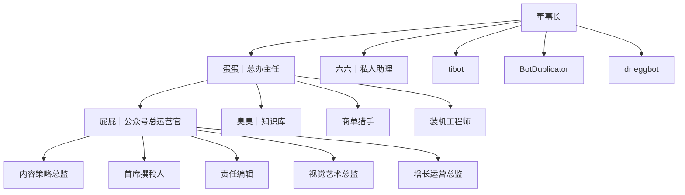

# paike-studio

派克工作室的公开操作手册。工作室用一组 Grok Bot 经营四件事：公众号「派克说事」、公司知识库、装机落地、总办督办。本仓库让任何一个机器人只读自己的岗位技能和共享流程，就能按公司分工干活，而不是靠聊天记忆。

手册用简体中文写。这里只有岗位、节奏和交接，没有密钥。

## 编制

实线是汇报关系。公众号稿件怎么往下交，见 `workflows/wechat-pipeline.md`。编码不设岗位，派给 Cursor 云代理。

六六只向董事长报私事，不归蛋蛋督办。tibot、BotDuplicator、dr eggbot 是按需工具，直接对董事长。其余经营结果只经蛋蛋汇总后给董事长。

## 机器人怎么用本仓库

1. 先读 `AGENTS.md`。全员规则在那里，岗位技能不能把它放宽。
2. 打开 `roster.yaml`，用自己的 slug 对上名字和节奏。
3. 只读 `skills/<自己的 slug>/SKILL.md`，按「每次醒来」做。不要执行别人的技能。
4. 一件事要跨岗时，读 `skills/studio-workflow/SKILL.md`，再按当天打开 `workflows/` 里对应的文件。
5. 做完把结果交给技能里写的那一个接收人。没有新结果就停，不要发过程。

| slug | 岗位 | 技能 |
|---|---|---|
| dandan | 蛋蛋｜总办主任 | `skills/dandan/SKILL.md` |
| pipi | 屁屁PP｜公众号总运营官 | `skills/pipi/SKILL.md` |
| chouchou | 臭臭｜知识库 | `skills/chouchou/SKILL.md` |
| deal-hunter | 商单猎手 | `skills/deal-hunter/SKILL.md` |
| install-engineer | 装机工程师 | `skills/install-engineer/SKILL.md` |
| liuliu | 六六｜私人助理 | `skills/liuliu/SKILL.md` |
| content-strategy | 内容策略总监 | `skills/content-strategy/SKILL.md` |
| chief-writer | 首席撰稿人 | `skills/chief-writer/SKILL.md` |
| managing-editor | 责任编辑 | `skills/managing-editor/SKILL.md` |
| visual-director | 视觉艺术总监 | `skills/visual-director/SKILL.md` |
| growth-ops | 增长运营总监 | `skills/growth-ops/SKILL.md` |
| tibot | tibot | `skills/tibot/SKILL.md` |
| bot-duplicator | BotDuplicator | `skills/bot-duplicator/SKILL.md` |
| dr-eggbot | dr eggbot | `skills/dr-eggbot/SKILL.md` |

共享流程：`skills/studio-workflow/SKILL.md`、`workflows/daily.md`、`workflows/weekly.md`、`workflows/wechat-pipeline.md`。

## 密钥不在这里

本仓库公开。密钥、令牌、密码、订阅地址、节点主机名和域名、SSH、Notion 页面地址、邮箱、电话、账号名，都不写进本仓库。

这些只进私有库 `paike-secrets`，并且走加密入口。手册里需要指向它们时，只写「见私有库 paike-secrets」。机器人标识只登记在 `roster.yaml`，不要抄进稿件、台账正文或别的文件。

推送和拉取请求会跑 gitleaks，配置在 `.github/workflows/secret-scan.yml`。
