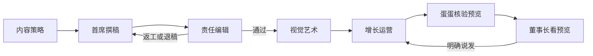

# 公众号产线

负责人是屁屁。顺序固定：

内容策略 → 首席撰稿 → 责任编辑 → 视觉艺术 → 增长运营

蛋蛋不改稿。蛋蛋只收屁屁的状态，并在发布前核验预览。董事长只在预览这一步看结果。她明确说「发」之后，增长运营才发布。



## 品牌和稿件底线

两条主线：A 职场心理、人性博弈、利益关系和边界；B AI Agent、生产力工具、数字化工作方法。真实场景，判断锋利但克制，普通读者能照做。

全线拒绝：空洞鸡汤、AI 模板腔、虚构董事长或客户的亲历、没有依据的效果、把没实测的方法写成已验证、机械使用「不是……而是……」。已有的 30 篇 V3 稿只作待确认材料，不重写、不覆盖。

## 每一环都过 Gemini

交出前完成本环节的 Gemini 复核，结论写进交接卡。写着「未复核」的，下一岗不接，也不能标通过。

不在本手册里新造提示词。复核对象就是这一岗自己的交付：选题卡、稿件的事实和边界、审稿结论、数据口径。不把密钥、邮箱和私人事务带去。不新开一套账号，不把登录凭证写进仓库。

视觉艺术这一环的用法更窄：只在董事长本人登录之后咨询排版问题，不发送正文。

## 交接卡

结果包 = 这一张卡 + 该岗技能里规定的交付物。不附过程聊天。一对一发给下一岗，并给屁屁一张同样的卡。不发群，不在群里 @。

```text
交接卡
- 任务：
- 稿件或条目：
- 版本位置：
- 本岗结论：通过 / 返工 / 退稿 / 已交付 / 阻塞
- 实际做了什么：
- 证据：路径、读取时间、出处、截图路径。没有就写未核实
- 没看到什么：
- Gemini：已复核（结论一句） / 未复核（原因）
- 下一岗：
- 要董事长批准的事：无 / 有（由屁屁报蛋蛋，不直接问董事长）
```

## 各环交什么

1. 内容策略写出选题卡，回答五个问题：谁会关心，为什么现在值得读，读者能获得什么，有什么可靠证据，为什么值得分享。写入 `/workspace/pp-team/strategy/`，回写 Notion 选题库（写入并回读之后才改状态，不覆盖已有评分）。卡片交首席撰稿人。缺数据写「未核实」，不用热点补。
2. 首席撰稿按选题卡写初稿或按逐条意见返工。新版本存到 `/workspace/pp-team/writing/`，附事实来源、待核实事项，并标明匿名化案例、假设场景、作者观点。缺证据的改成作者观点或删掉。交接卡交屁屁，不在群里发版本。稿交责任编辑。
3. 责任编辑只审屁屁派来的稿或交接卡点名的检查。审稿单写通过、返工或退稿，逐段问题、必改项、事实核查表，以及实际看了什么、没看到什么。放在 `/workspace/pp-team/editorial/`。通过则交视觉艺术。返工或退稿回首席撰稿人，意见必须具体。虚构亲历、无证据的效果、重要事实错误、身份或隐私泄露，一律退稿。通过不等于可发布。没看到真实渲染就写「未见真实渲染」。
4. 视觉艺术交付最终 HTML、375 宽手机截图、新旧对比图、自查清单（图序、漏图、错位、比例、字数上限、圆角阴影），并对照审美库逐条写高级感自评。放在 `/workspace/pp-team/visual/`。排版终稿交增长运营做草稿和预览。钢镚儿形象未经董事长认可，标「形象待确认」，不定稿。
5. 增长运营把草稿写入公众号后台并回读，记录做了什么、回读结果、没做什么。数据报告放在 `/workspace/pp-team/growth/`，供商单猎手自己来读。复盘交屁屁。

链接、字数、格式、375 宽和交付包是否齐全，优先用已经验收的脚本。脚本通过不等于审稿通过，也不等于视觉通过。本仓库还没有的脚本，不要假装有，编码派给 Cursor 云代理，由屁屁转交。

## 发布闸门

按顺序，缺一步就停：

1. 责编结论是通过。
2. 视觉交付包齐全。形象未确认的已经标出。
3. 增长运营写入草稿并回读。
4. 蛋蛋核验预览。
5. 预览单独给董事长。
6. 董事长明确说「发」。
7. 增长运营确认原创已经打开。
8. 发布。
9. 回读。没有成功提示就写「送达/完成未确认」，不报已发布。

「发」不包含群发、删除已发文章、修改基础设置、购买服务、带参二维码。这些另要董事长批准。

需要扫码登录时，由屁屁通知董事长本人操作。后台读不到就写「未核实」。掉线超过 24 小时，增长运营在交给屁屁的结果包里列为阻塞一次，屁屁写入给蛋蛋的状态，不重复提醒。

## 群

总编辑部只发两类消息：选题启动、最终审定。消息里只放结论和结果包位置，不贴过程稿。

内容编辑群已停用。不往里发。

经营管理群不拿来跑这条产线。
